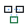

<picture>
  <source media="(prefers-color-scheme: dark)" srcset="assets/banner-dark.svg">
  <source media="(prefers-color-scheme: light)" srcset="assets/banner-light.svg">
  
</picture>

I have 4+ years of engineering experience, 3 of them full-time in robotics. I am the technical lead of a ROS 2 multi-robot system for search and rescue and outdoor patrol. It runs on 6 real robots (Husarion ROSbot and Panther, Clearpath Jackal), with up to 4 at once in weekly field tests in Saudi Arabia and up to 20 in NVIDIA Isaac Sim. My work covers multi-robot mission allocation, Nav2 and slam_toolbox, multi-robot map merging and frontier exploration, outdoor patrol with 3D LiDAR and GPS, CI/CD with multi-arch Docker, and bringing an AI team's LLM and VLM features onto the robots. I come from embedded work (STM32, PCB design), and I teach ROS 2 through the ETGAH Masterclass and student robotics projects. I am open to robotics software roles in the UAE, Saudi Arabia and Europe.

### Side project

DesBot, my robotics side project.

  
  
  

### What I work on

<table>
  <tr>
    <td width="50%" valign="top">
      <picture><source media="(prefers-color-scheme: dark)" srcset="assets/icon-multi-robot-dark.svg"></picture>&nbsp; <b>Multi-robot systems</b> 
      Mission allocation for a ROS 2 fleet, up to 4 real robots at once and up to 20 in Isaac Sim.
    </td>
    <td width="50%" valign="top">
      <picture><source media="(prefers-color-scheme: dark)" srcset="assets/icon-navigation-dark.svg"></picture>&nbsp; <b>Navigation and SLAM</b> 
      Nav2 and slam_toolbox, multi-robot map merging and frontier exploration.
    </td>
  </tr>
  <tr>
    <td width="50%" valign="top">
      <picture><source media="(prefers-color-scheme: dark)" srcset="assets/icon-perception-dark.svg"></picture>&nbsp; <b>Perception and sensors</b> 
      Outdoor patrol with 3D LiDAR and GPS; LLM and VLM features running on the robots.
    </td>
    <td width="50%" valign="top">
      <picture><source media="(prefers-color-scheme: dark)" srcset="assets/icon-edge-ci-dark.svg"></picture>&nbsp; <b>Edge deployment and CI</b> 
      CI/CD with multi-arch Docker images; embedded roots in STM32 and PCB design.
    </td>
  </tr>
</table>

### Tech stack

  LANGUAGES 
  
  
  

  ROBOTICS 
  
  
  
  
  

  HARDWARE 
  
  
  
  
  
  

  EMBEDDED 
  
  
  
  
  
  
  

  TOOLS 
  
  
  
  
  

### Featured projects

<table>
  <tr>
    <td width="50%" valign="top">
      <a href="https://github.com/a-eldesouky/planning_stack"><picture><source media="(prefers-color-scheme: dark)" srcset="https://github-readme-stats.vercel.app/api/pin/?username=a-eldesouky&repo=planning_stack&bg_color=16191D&title_color=2FB36E&text_color=EEF0F1&icon_color=4A9EFF&border_color=2A2F35&border_radius=0"></picture></a> 
      Six-stage autonomous driving planner in C++17 on ROS 2 Humble, running in CARLA (A*, BehaviorTree.CPP v4, Hybrid A*, Pure Pursuit).
    </td>
    <td width="50%" valign="top">
      <a href="https://github.com/a-eldesouky/cpp-skills"><picture><source media="(prefers-color-scheme: dark)" srcset="https://github-readme-stats.vercel.app/api/pin/?username=a-eldesouky&repo=cpp-skills&bg_color=16191D&title_color=2FB36E&text_color=EEF0F1&icon_color=4A9EFF&border_color=2A2F35&border_radius=0"></picture></a> 
      C++ Core Guidelines, Google C++ and ROS 2 C++ style skills for AI coding agents, with CI.
    </td>
  </tr>
  <tr>
    <td width="50%" valign="top">
      <a href="https://github.com/a-eldesouky/ros2-env"><picture><source media="(prefers-color-scheme: dark)" srcset="https://github-readme-stats.vercel.app/api/pin/?username=a-eldesouky&repo=ros2-env&bg_color=16191D&title_color=2FB36E&text_color=EEF0F1&icon_color=4A9EFF&border_color=2A2F35&border_radius=0"></picture></a> 
      One-command ROS 2 Jazzy, Gazebo, Nav2 and slam_toolbox setup with Docker.
    </td>
    <td width="50%" valign="top">
      <a href="https://github.com/a-eldesouky/Robotics_Documentation"><picture><source media="(prefers-color-scheme: dark)" srcset="https://github-readme-stats.vercel.app/api/pin/?username=a-eldesouky&repo=Robotics_Documentation&bg_color=16191D&title_color=2FB36E&text_color=EEF0F1&icon_color=4A9EFF&border_color=2A2F35&border_radius=0"></picture></a> 
      Planning and localisation study notes with C++ examples.
    </td>
  </tr>
  <tr>
    <td width="50%" valign="top">
      <a href="https://github.com/a-eldesouky/Cplusplus_Notes"><picture><source media="(prefers-color-scheme: dark)" srcset="https://github-readme-stats.vercel.app/api/pin/?username=a-eldesouky&repo=Cplusplus_Notes&bg_color=16191D&title_color=2FB36E&text_color=EEF0F1&icon_color=4A9EFF&border_color=2A2F35&border_radius=0"></picture></a>  
      C++ language study notes.
    </td>
    <td width="50%" valign="top">
      <a href="https://github.com/a-eldesouky/Graduation_Project_HSRobot"><picture><source media="(prefers-color-scheme: dark)" srcset="https://github-readme-stats.vercel.app/api/pin/?username=a-eldesouky&repo=Graduation_Project_HSRobot&bg_color=16191D&title_color=2FB36E&text_color=EEF0F1&icon_color=4A9EFF&border_color=2A2F35&border_radius=0"></picture></a> 
      Graduation project (grade Excellent): hospital assistant robot. I owned the robot base and indoor navigation.
    </td>
  </tr>
</table>

### Udacity Nanodegrees

<table>
  <tr>
    <td width="33%" valign="top">
      <b>C++</b> 
      Capstone: <a href="https://github.com/a-eldesouky/CPP-SnakeGame">CPP-SnakeGame</a>, a 2D Snake game in C++ and SDL.
    </td>
    <td width="33%" valign="top">
      <b>Robotics Software Engineer</b> 
      Final project: <a href="https://github.com/a-eldesouky/Home_Service_Robot">Home_Service_Robot</a>, SLAM mapping, localisation and navigation to pick-up and drop-off goals.
    </td>
    <td width="34%" valign="top">
      <b>Self-Driving Car Engineer</b> 
      Projects: <a href="https://github.com/a-eldesouky/SDC-Object-Detection">object detection</a>, <a href="https://github.com/a-eldesouky/SDC-Sensor-Fusion">sensor fusion</a>, <a href="https://github.com/a-eldesouky/SDC-Localization">localisation</a>, <a href="https://github.com/a-eldesouky/SDC-Planning">planning</a>, <a href="https://github.com/a-eldesouky/SDC-PID-Control">PID control</a>.
    </td>
  </tr>
</table>

### GitHub stats

  <picture>
    <source media="(prefers-color-scheme: dark)" srcset="https://github-readme-stats.vercel.app/api?username=a-eldesouky&show_icons=true&hide_rank=true&count_private=false&bg_color=16191D&title_color=2FB36E&text_color=EEF0F1&icon_color=4A9EFF&border_color=2A2F35&border_radius=0">
    
  </picture>
  <picture>
    <source media="(prefers-color-scheme: dark)" srcset="https://github-readme-stats.vercel.app/api/top-langs/?username=a-eldesouky&layout=compact&hide=jupyter%20notebook,makefile,cmake,html,common%20lisp,javascript,css,dockerfile&langs_count=4&bg_color=16191D&title_color=2FB36E&text_color=EEF0F1&border_color=2A2F35&border_radius=0">
    
  </picture>

  <picture>
    <source media="(prefers-color-scheme: dark)" srcset="https://raw.githubusercontent.com/a-eldesouky/a-eldesouky/output/snake-dark.svg">
    
  </picture>

### Contact

  
  

